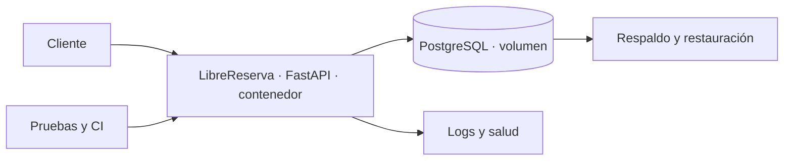

# AWS Academy y proyecto LibreReserva

Este paquete publica las actividades del bloque orientado por el **Dr. Esteban Hernández Barragán**, semanas 9–16. Mantiene separados dos recorridos:

1. **AWS Academy Cloud Foundations:** módulos oficiales con su propia numeración.
2. **Informática I:** evolución acumulativa de LibreReserva en un ambiente local reproducible.

Los módulos 1–8 de Cloud Foundations se registran como desarrollados. El módulo 9 acompaña la semana 10 y el módulo 10 acompaña la semana 14. Un módulo AWS no equivale a una semana ni a una carpeta `modules/` del repositorio.

## Arquitectura única del proyecto

LibreReserva no se reimplementa con Lambda, DynamoDB o SQS. Learner Lab se usa solamente para actividades oficiales de Cloud Foundations que hayan sido verificadas por el docente. La evidencia del proyecto debe poder reproducirse con Docker o Podman, Compose y PostgreSQL local.

## Ruta de ocho sesiones

| Semana | Fecha | Actividad publicada | Producto acumulativo | Relación con AWS Academy |
|---:|---|---|---|---|
| 9 | 14 oct. | [Docker y despliegue local](sesiones/09_entorno/README.md) | Imagen, contenedor y pérdida de estado demostrada | Conocimientos de cómputo del módulo 6 |
| 10 | 27 oct. | [Persistencia en archivos](sesiones/10_calidad/README.md) | Dos instancias, Parquet compartido y bloqueo local | Módulo 9: arquitectura en la nube |
| 11 | 28 oct. | [Persistencia e integridad](sesiones/11_hexagonal/README.md) | PostgreSQL, migración y concurrencia | Módulo 8: bases de datos |
| 12 | 4 nov. | [API confiable](sesiones/12_distribuidos/README.md) | Idempotencia, salud real y recuperación | Fiabilidad del módulo 9 |
| 13 | 11 nov. | [Entrega segura y trazable](sesiones/13_api_eventos/README.md) | Pruebas, CI, imagen y configuración | Excelencia operacional y seguridad |
| 14 | 18 nov. | [Operación y recuperación](sesiones/14_pruebas_entrega/README.md) | Logs, medición, respaldo y restauración | Módulo 10: monitoreo y escalado |
| 15 | 25 nov. | [Integración autónoma](sesiones/15_proyecto/README.md) | Versión candidata desde clon limpio | Aplicación de módulos 9–10 |
| 16 | 2 dic. | [Demostración y cierre](sesiones/16_cierre/README.md) | Fallo, recuperación y defensa | Cierre y limpieza |

## Convenciones

- Una rama corta y un pull request por incremento.
- Ninguna credencial se almacena en Git, la imagen o las evidencias.
- PostgreSQL es el único almacén del proyecto.
- Las migraciones son parte del código y se ejecutan desde un clon limpio.
- Cada capacidad se demuestra con una prueba o un procedimiento reproducible.
- Si una actividad oficial usa Learner Lab, se registran consumo y limpieza, pero no se crea una arquitectura alternativa del proyecto.

## Evidencia común

Cada equipo conserva en su repositorio:

- commit y pull request;
- comandos ejecutados y resultados relevantes;
- pruebas automatizadas;
- ADR y diagrama vigentes;
- medición o caso de fallo de la sesión;
- confirmación de ausencia de secretos;
- limpieza de recursos AWS, únicamente cuando se hayan utilizado.

La [plantilla de evidencia](evidencias/PLANTILLA.md) organiza estos elementos. Las capturas apoyan la entrega, pero no sustituyen comandos, pruebas ni explicaciones.

## Definición común de terminado

Desde un clon limpio, un evaluador debe poder ejecutar pruebas, construir la imagen, levantar API y PostgreSQL, aplicar migraciones, crear una reserva, reiniciar la API sin perderla, comprobar concurrencia e idempotencia, provocar una indisponibilidad, recuperar el servicio y restaurar un respaldo.
