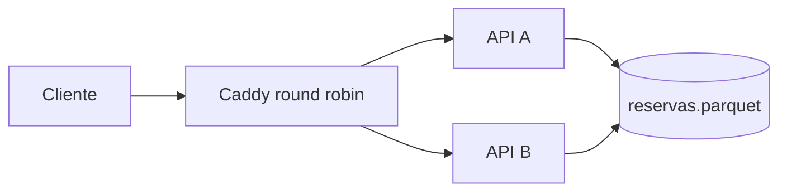

# Laboratorio: persistencia compartida en Parquet

## Propósito

Observar qué cambia cuando dos instancias de LibreReserva dejan de guardar reservas en RAM y leen y escriben el mismo archivo Parquet. El experimento compara una implementación sin coordinación con una mitigación basada en bloqueo de archivo y reemplazo atómico.

Parquet es un formato columnar útil para intercambio y análisis de datos. Este laboratorio fuerza un patrón operacional de lectura, validación y reescritura completa para hacer visibles sus límites como almacenamiento compartido entre dos procesos.

## Arquitectura del experimento



Las dos API montan el mismo volumen. `WRITE_DELAY_MS` amplía deliberadamente la ventana de carrera para que dos solicitudes puedan leer la misma versión antes de escribir.

## Preparación

Desde la raíz del repositorio:

```bash
docker compose -p librereserva-parquet \
  -f aws-learner-lab/sesiones/10_calidad/compose-parquet.yml \
  config
docker compose -p librereserva-parquet \
  -f aws-learner-lab/sesiones/10_calidad/compose-parquet.yml \
  up -d --build
```

Compruebe la distribución:

```bash
for intento in 1 2 3 4; do
  curl -fsS http://127.0.0.1:8080/salud/viva
  echo
done
```

Las respuestas deben alternar entre `api_a` y `api_b`.

## Experimento sin coordinación

Ejecute dos solicitudes incompatibles casi al mismo tiempo:

```bash
for intento in 1 2; do
  curl -sS -i -X POST http://127.0.0.1:8080/reservas \
    -H 'content-type: application/json' \
    -d '{"recurso":"A-101","inicio":"2026-10-27T18:00:00-05:00","fin":"2026-10-27T19:00:00-05:00"}' &
done
wait
```

Consulte el resultado y los logs:

```bash
curl -i http://127.0.0.1:8080/reservas
docker compose -p librereserva-parquet \
  -f aws-learner-lab/sesiones/10_calidad/compose-parquet.yml \
  logs --tail=80 api_a api_b
```

Resultados posibles:

- ambas solicitudes responden `201`, aunque son incompatibles;
- una escritura reemplaza la actualización de la otra;
- ambas calculan el mismo identificador;
- una lectura encuentra el archivo mientras otra instancia lo está reescribiendo y responde `503`;
- el archivo final es válido, pero no representa todas las confirmaciones entregadas a los clientes.

La falla no está en Caddy. El ciclo leer, validar y escribir ocurre de forma independiente en cada proceso.

## Experimento con bloqueo local

Retire únicamente los contenedores y el volumen de este laboratorio para comenzar con un archivo vacío:

```bash
docker compose -p librereserva-parquet \
  -f aws-learner-lab/sesiones/10_calidad/compose-parquet.yml \
  down -v
```

Repita el montaje activando el bloqueo:

```bash
PARQUET_LOCK_MODE=flock docker compose -p librereserva-parquet \
  -f aws-learner-lab/sesiones/10_calidad/compose-parquet.yml \
  up -d --build
```

Ejecute nuevamente las dos solicitudes concurrentes. La primera debe responder `201`; la segunda debe esperar el bloqueo, leer el nuevo estado y responder `409`.

El modo `flock` mantiene el bloqueo durante todo el ciclo leer, validar y escribir. La escritura se realiza en un archivo temporal del mismo volumen y termina con `os.replace`, de modo que los lectores no deberían observar un Parquet parcialmente escrito.

## Análisis de la mitigación

El bloqueo mejora este ensayo porque las dos instancias están en el mismo host y montan un volumen cuyo sistema de archivos reconoce `flock`. No convierte Parquet en una base de datos:

- todas las escrituras quedan serializadas por un único bloqueo;
- cada reserva obliga a leer y reescribir el archivo completo;
- el identificador y la integridad dependen del código de la aplicación;
- el comportamiento de los bloqueos puede cambiar en NFS, almacenamiento de objetos u otros sistemas distribuidos;
- no hay transacciones, aislamiento ni recuperación coordinada después de una escritura interrumpida;
- una réplica ejecutada en otro host requiere un mecanismo de coordinación adicional.

## Evidencia

Entregue:

1. respuestas HTTP de las dos solicitudes sin bloqueo;
2. estado final del archivo consultado mediante la API;
3. respuestas HTTP con `PARQUET_LOCK_MODE=flock`;
4. diagrama con la sección crítica;
5. explicación de por qué el bloqueo local es una mitigación limitada al sistema de archivos compartido.

## Cierre

```bash
docker compose -p librereserva-parquet \
  -f aws-learner-lab/sesiones/10_calidad/compose-parquet.yml \
  down -v
```

El comando elimina únicamente los contenedores, la red y el volumen creados con el proyecto `librereserva-parquet`.
