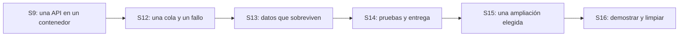

# Contenedores y despliegue: ruta por sesiones

Esta ruta distribuye los temas de la presentación CyberColombia de contenedores, versión 9, sin convertir la sesión 9 en un curso completo de infraestructura. Conserva las fechas y los temas de la agenda oficial. Los módulos son materiales de consulta, no sesiones adicionales.

## Recorrido y alcance

| Sesión | Pregunta que orienta la clase | Práctica mínima | Continuación o ampliación |
|---:|---|---|---|
| 9 · 14 oct. | ¿Cómo ejecuto la misma aplicación en otro equipo? | Git, `.venv`, elección de un motor, imagen, contenedor, `/docs`, reinicio y PR | Sin Compose, bases de datos, colas, Kubernetes ni despliegue AWS obligatorio |
| 10 · 21 oct. | ¿Cómo sé si la aplicación cumple lo esperado? | Escenario de calidad y medición de la API ya conocida | Sin instalar plataformas nuevas |
| 11 · 28 oct. | ¿Dónde deben vivir las reglas y los adaptadores? | Agenda en memoria, dominio y puerto de persistencia | Preparar la integración, no desplegar varios servicios |
| 12 · 4 nov. | ¿Cuándo conviene separar una tarea? | YAML, Compose y una cola: publicar, recibir y repetir un mensaje | Elegir RabbitMQ local o SQS, no realizar ambos talleres |
| 13 · 11 nov. | ¿Cómo sobreviven los datos y cómo se publica un evento? | PostgreSQL y volumen, transacción y análisis de doble escritura | Integración progresiva y outbox como incremento del proyecto |
| 14 · 18 nov. | ¿Cómo pruebo y entrego una versión identificable? | Pruebas, CI con construcción de imagen, Deployment, Service, acceso y recuperación | Elegir Kubernetes local o extensión ECR; no añadir TLS ni telemetría completa |
| 15 · 25 nov. | ¿Qué necesita mejorar nuestro proyecto? | Un incremento de cuatro horas elegido y aprobado por equipo | Escalado/rollback, configuración/secretos/volumen, ensayo de proxy TLS o telemetría: elegir uno |
| 16 · 2 dic. | ¿Otra persona puede reproducir y explicar el resultado? | Demo, caso de fallo, trazabilidad y limpieza | Sin introducir tecnologías nuevas |

En la presentación V9, use las diapositivas 3–21 para la sesión 9. Las 22–28 apoyan las sesiones 12–13. Las 29–33 sirven como lectura de despliegue para el proyecto. Las 35–38 y 41 apoyan la sesión 14. Reserve las 39–40 y 42 para las ampliaciones o la defensa de decisiones. Las portadas y separadores no son contenido adicional evaluable. No es necesario proyectar toda la presentación en una clase.

## Material que se puede ejecutar y material por desarrollar

| Capacidad | Estado de la base del curso | Material |
|---|---|---|
| API con agenda en RAM, `.venv`, Docker/Podman | Implementado | [Práctica de sesión 9](../modules/01_entorno/PRACTICA_CONTENEDORES.md) |
| Sintaxis y significado de YAML | Guía con ejemplos reales | [YAML para el laboratorio](YAML_PARA_LABORATORIOS.md) |
| PostgreSQL/RabbitMQ y volúmenes | Configuración ejecutable, puertos solo en loopback | [Laboratorio de datos y mensajes](../modules/06_apis_datos_eventos/LABORATORIO.md) |
| Productor, cola y recepción de un mensaje | Demo independiente con API HTTP de administración | [Laboratorio, etapa sesión 12](../modules/06_apis_datos_eventos/LABORATORIO.md#sesión-12-un-mensaje-y-un-reintento) |
| API conectada a PostgreSQL y RabbitMQ | Ejercicio de implementación; no incluido en la API base | [Incrementos de integración](../modules/06_apis_datos_eventos/LABORATORIO.md#sesión-13-persistencia-y-transacciones) |
| CI con pruebas, imagen y archivo descargable | Flujo definido; requiere ejecutar Actions en una forja | [Flujo CI](../.github/workflows/validate.yml) |
| Registro ECR | Extensión manual opcional | [Sesión 14](../aws-learner-lab/sesiones/14_pruebas_entrega/README.md) |
| Kubernetes local, acceso y recuperación | Manifiesto y taller | [Módulo 8](../modules/08_entrega_plataforma/README.md) |
| Escalado, actualización y vuelta atrás | Taller opcional; no resuelve los datos compartidos | [Operación](../modules/08_entrega_plataforma/OPERACION.md) |
| ConfigMap, Secret y volumen | Demo separada de la API | [Operación](../modules/08_entrega_plataforma/OPERACION.md) |
| Proxy TLS y ambientes | Ensayo local, no configuración apta para producción real | [Despliegue y ambientes](../modules/08_entrega_plataforma/DESPLIEGUE.md) |
| Logs y diagnóstico mínimo | Taller ligero sin instalar backends | [Observabilidad](../modules/09_observabilidad/README.md) |
| Métricas/trazas centralizadas | Ampliación guiada y demo externa | [Observabilidad](../modules/09_observabilidad/README.md) |

## Control de carga

Las instalaciones se preparan antes de la sesión que las necesita. No se exige aprender dos motores, dos brokers ni dos plataformas para acreditar el mismo resultado. Cada entrega conserva un caso feliz, un fallo explicado y una decisión. Las extensiones deben sustituir parte del taller del equipo, no sumarse a todas las actividades obligatorias.

Las cuatro horas de sesión 15 incluyen validación y limpieza. Si una ampliación no se practicó o no fue anunciada por el docente, no se convierte en requisito de la defensa final. La sesión 9 no requiere subir imágenes a un registro ni crear recursos AWS.
