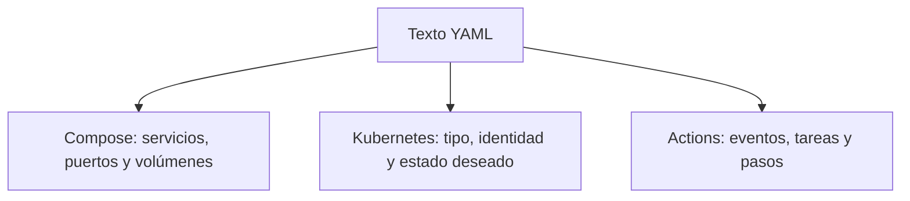

# YAML para los laboratorios

YAML es un formato de texto para organizar datos. `.yml` y `.yaml` indican el mismo formato. La herramienta que lo lee determina el significado: Compose interpreta servicios; Kubernetes interpreta objetos; Actions interpreta tareas.


## Lectura de un ejemplo real

Fragmento del [Compose del módulo 6](../modules/06_apis_datos_eventos/compose.yml):

```yaml
services:
  rabbitmq:
    image: docker.io/library/rabbitmq:4-management-alpine
    ports:
      - "127.0.0.1:5672:5672"
      - "127.0.0.1:15672:15672"
    volumes:
      - reservas_rabbit:/var/lib/rabbitmq
```

| Elemento | Cómo leerlo |
|---|---|
| `clave: valor` | Un dato con nombre, como `image` |
| Sangría | Una relación de pertenencia: `image` pertenece a `rabbitmq` |
| `-` | Un elemento de una lista, como cada publicación de puerto |
| Comillas | Conservan una cadena, especialmente puertos y valores que parecen números |
| `# comentario` | Explicación para quien lee el archivo |

Use espacios, no tabuladores. Mantenga la misma sangría dentro de cada nivel. Este fragmento no es un Compose completo: también se declara el volumen al final del archivo real.



## Mismo formato, propósitos distintos

En [Kubernetes](../modules/08_entrega_plataforma/k8s.yml), `kind: Deployment` identifica el tipo de objeto, `metadata.name` su nombre y `spec.replicas: 2` cuántas copias mantener. `---` separa documentos: el archivo contiene un Deployment y un Service.

Una clave inventada puede ser YAML válido y no ser una configuración aceptada por la herramienta. Por eso se comprueban tanto el formato como el esquema y el comportamiento.

## Comprobación por etapa

En sesión 12, con el motor elegido y Compose preparado:

```bash
podman compose -f modules/06_apis_datos_eventos/compose.yml config
# Alternativa: docker compose -f modules/06_apis_datos_eventos/compose.yml config
```

En sesión 14, con el clúster local activo:

```bash
kubectl apply --dry-run=server -f modules/08_entrega_plataforma/k8s.yml
```

`config` puede mostrar variables y credenciales de laboratorio. No publique esa salida si contiene secretos reales. `--dry-run=server` consulta el clúster, pero no persiste los objetos.

**Ejercicio de cinco minutos:** encuentre en los archivos reales una imagen, una lista y un puerto. Explique por qué el puerto 80 del Service llega al 8000 de la API y por qué Compose usa 15672 para la consola de RabbitMQ.

Fuentes: [especificación YAML](https://yaml.org/spec/1.2.2/), [Compose](https://docs.docker.com/reference/compose-file/) y [objetos de Kubernetes](https://kubernetes.io/docs/concepts/overview/working-with-objects/).
