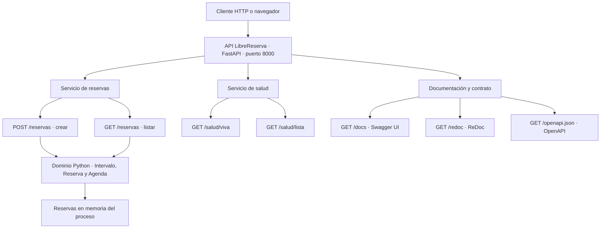

# API de LibreReserva

LibreReserva permite crear y consultar reservas de recursos institucionales. La API local, versión `0.1.0`, ofrece un servicio de reservas y un servicio de salud. Las reservas se almacenan en la memoria del proceso y se pierden al reiniciarlo.

Esta guía describe la implementación de [app/main.py](app/main.py) y las reglas de [app/domain.py](app/domain.py). La plantilla Lambda de los laboratorios AWS contiene una implementación independiente con un contrato diferente.

## Arquitectura y servicios



Los servicios del diagrama son capacidades de una misma aplicación; no se ejecutan como microservicios separados. FastAPI recibe y valida las solicitudes, y el dominio aplica las reglas de reservas sin depender del framework HTTP.

## Inicio de la API

Desde la raíz del repositorio:

En Linux nativo, ejecute los comandos en Bash y prepare Git, Make, Python y `venv` con la [guía de entorno para Linux](../../modules/01_entorno/README.md#linux-nativo-con-debian-o-ubuntu). En Windows, use la terminal de Debian/Ubuntu en WSL2; en macOS, use Terminal.

```bash
./scripts/setup_python.sh --apply
make test
make run
```

La URL base local es `http://127.0.0.1:8000`. Los ejemplos siguientes usan esa dirección.

## Catálogo de endpoints

| Servicio | Método | Endpoint | Función | Respuesta normal |
|---|---|---|---|---|
| Reservas | POST | `/reservas` | Crear una reserva | `201 Created` y reserva creada |
| Reservas | GET | `/reservas` | Listar todas las reservas del proceso | `200 OK` y arreglo JSON |
| Salud | GET | `/salud/viva` | Comprobar que la aplicación responde | `200 OK` y estado `viva` |
| Salud | GET | `/salud/lista` | Consultar la señal actual de disponibilidad | `200 OK` y estado `lista` |
| Documentación | GET | `/docs` | Explorar y probar la API con Swagger UI | Página HTML |
| Documentación | GET | `/redoc` | Consultar la referencia con ReDoc | Página HTML |
| Contrato | GET | `/openapi.json` | Obtener el esquema OpenAPI | Documento JSON |

La API actual no requiere autenticación. No ofrece edición, cancelación, consulta por identificador, administración de recursos ni filtros de búsqueda.

## Servicio de reservas

### Crear una reserva

`POST /reservas` recibe un cuerpo JSON con `Content-Type: application/json`.

| Campo | Tipo | Obligatorio | Significado |
|---|---|---|---|
| `recurso` | Cadena | Sí | Identificador del recurso, por ejemplo `A-101` |
| `inicio` | Fecha y hora | Sí | Inicio del intervalo |
| `fin` | Fecha y hora | Sí | Final del intervalo, posterior al inicio |

Use fechas ISO 8601 con zona horaria, como `2026-10-14T18:00:00Z`. `Z` indica UTC; para expresar las 6:00 p. m. de Bogotá, use `2026-10-14T18:00:00-05:00`. La implementación no exige zona horaria ni normaliza todas las fechas a UTC; mantenga una convención consistente para evitar comparaciones entre fechas con y sin zona.

```bash
curl -i -X POST http://127.0.0.1:8000/reservas \
  -H 'Content-Type: application/json' \
  -d '{"recurso":"A-101","inicio":"2026-10-14T18:00:00-05:00","fin":"2026-10-14T19:00:00-05:00"}'
```

En un proceso recién iniciado, la respuesta es `201 Created` con un cuerpo equivalente a:

```json
{
  "recurso": "A-101",
  "inicio": "2026-10-14T18:00:00-05:00",
  "fin": "2026-10-14T19:00:00-05:00",
  "id": 1
}
```

El servidor asigna `id`; el cliente no necesita enviarlo. Las reglas actuales son:

- `fin` debe ser estrictamente posterior a `inicio`.
- Dos reservas del mismo recurso no pueden solaparse.
- Una reserva puede comenzar justo cuando termina otra del mismo recurso.
- Recursos diferentes pueden reservarse durante el mismo intervalo.

El recurso se compara por igualdad de cadenas. No existe un catálogo que compruebe su existencia ni una validación explícita que rechace nombres vacíos o normalice espacios y mayúsculas. Tampoco se impide reservar fechas pasadas.

### Errores al crear una reserva

| Código | Causa | Cuerpo |
|---|---|---|
| `409 Conflict` | Solapamiento con una reserva del mismo recurso | `{"detail":"A-101 ya está reservado"}` |
| `422 Unprocessable Entity` | Final igual o anterior al inicio | `{"detail":"fin debe ser posterior a inicio"}` |
| `422 Unprocessable Entity` | Campos obligatorios ausentes o datos inválidos según Pydantic | Objeto con `detail` como lista de errores de validación |

Repetir el POST del ejemplo produce `409` mientras la reserva siga en la memoria del mismo proceso. No existe un mecanismo de idempotencia mediante encabezado en esta API local.

### Listar reservas

`GET /reservas` devuelve todas las reservas de la agenda actual. No recibe cuerpo ni define parámetros de filtrado o paginación.

```bash
curl -fsS http://127.0.0.1:8000/reservas
```

Respuesta `200 OK` después de crear la reserva anterior:

```json
[
  {
    "recurso": "A-101",
    "inicio": "2026-10-14T18:00:00-05:00",
    "fin": "2026-10-14T19:00:00-05:00",
    "id": 1
  }
]
```

Si no hay reservas, devuelve `[]`.

## Servicio de salud

### Comprobar vida

```bash
curl -fsS http://127.0.0.1:8000/salud/viva
```

`GET /salud/viva` responde `200 OK`:

```json
{"estado":"viva"}
```

### Comprobar disponibilidad

```bash
curl -fsS http://127.0.0.1:8000/salud/lista
```

`GET /salud/lista` responde `200 OK`:

```json
{"estado":"lista"}
```

Ambos endpoints devuelven estados fijos cuando la petición alcanza la aplicación. El endpoint de disponibilidad aún no comprueba base de datos, mensajería u otras dependencias. El [manifiesto Kubernetes](../../modules/08_entrega_plataforma/k8s.yml) los utiliza para sus probes de vida y disponibilidad.

## Documentación interactiva y contrato

Abra `http://127.0.0.1:8000/docs` para consultar los modelos y ejecutar solicitudes. Las operaciones de escritura realizadas desde Swagger UI crean reservas reales en la agenda del proceso.

`http://127.0.0.1:8000/redoc` ofrece una vista de referencia. El contrato JSON se obtiene con:

```bash
curl -fsS http://127.0.0.1:8000/openapi.json
```

Estos endpoints los proporciona FastAPI mediante la configuración actual de la aplicación.

## Ejecución en contenedores y límites actuales

El [Containerfile](Containerfile) empaqueta la misma API con Uvicorn y escucha en el puerto 8000. Prepare el motor con la [guía de instalación por sistema operativo](../../modules/01_entorno/README.md). En Linux, Podman funciona directamente; Docker Engine requiere que su servicio esté activo y que su usuario tenga acceso. Si usa Docker con `sudo`, anteponga `sudo` a ambos comandos Docker siguientes. Desde la raíz del repositorio, elija una ruta:

```bash
# Docker
# Ubuntu: instalar primero con ./scripts/install_docker_ubuntu.sh --apply
docker build -f labs/librereserva/Containerfile -t localhost/librereserva:0.1.0 labs/librereserva
docker run --rm -p 127.0.0.1:8000:8000 localhost/librereserva:0.1.0
```

```bash
# Podman
podman build -f labs/librereserva/Containerfile -t localhost/librereserva:0.1.0 labs/librereserva
podman run --rm -p 127.0.0.1:8000:8000 localhost/librereserva:0.1.0
```

Cada proceso conserva una agenda independiente. Recrear el contenedor elimina sus reservas; ejecutar varias réplicas no comparte los datos ni garantiza la ausencia de solapamientos entre réplicas. La comprobación y creación tampoco tienen protección explícita frente a solicitudes concurrentes dentro de un proceso.

PostgreSQL y RabbitMQ están definidos en el [Compose del módulo 6](../../modules/06_apis_datos_eventos/compose.yml), pero la API local aún no se conecta a ellos. Persistencia, publicación de eventos, autenticación y cancelación forman parte de la evolución prevista.

## Comprobación práctica

1. Inicie una sola instancia y consulte `/salud/viva` y `/salud/lista`.
2. Cree una reserva y compruebe `201`.
3. Repita el mismo POST y compruebe `409`.
4. Envíe un intervalo con `fin` anterior a `inicio` y compruebe `422`.
5. Liste las reservas y compruebe que la primera sigue presente.
6. Reinicie el proceso o recree el contenedor y compruebe que la lista vuelve a estar vacía.

Las pruebas automatizadas del dominio se ejecutan con `make test`. Las pruebas HTTP y de propiedades están en `modules/07_pruebas` y se incluyen en `make test-all` cuando el entorno de desarrollo está instalado.
