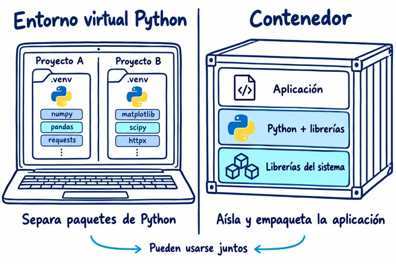
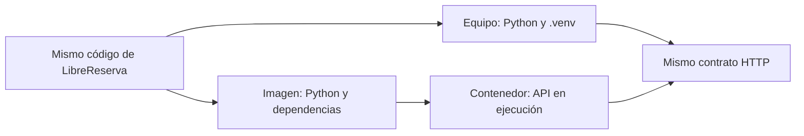

# Sesión 9: una aplicación, dos formas de ejecutarla

## Resultado

Ejecutar LibreReserva con un entorno virtual y con un contenedor, comprobar la API y explicar qué se pierde al reiniciar. Se usa un solo motor. PostgreSQL, RabbitMQ, Compose y Kubernetes se estudian después.

## Python y contenedores



| Opción | Qué separa o incluye | Cuándo usarla |
|---|---|---|
| `.venv` | Paquetes de Python por proyecto; usa el sistema del equipo | Editar y probar código localmente |
| Contenedor | Aplicación, intérprete y dependencias sobre una imagen | Ejecutar el mismo artefacto en otro equipo o levantar un servicio |
| `.venv` dentro de un contenedor | Un entorno Python dentro de la imagen | Cuando la estructura de la imagen o varios entornos Python lo justifican; no hace falta para este laboratorio |



Una `.venv` no incluye un sistema operativo ni hace portátil el proyecto por sí sola. No copie la `.venv` del equipo a la imagen: reconstruya las dependencias. El Containerfile del curso instala los paquetes directamente en el Python de la imagen.

Docker conviene cuando el equipo ya utiliza su ecosistema o necesita continuar con Docker Compose. Podman permite seguir la ruta del curso sin un demonio central y trabajar sin privilegios de administrador en Linux. Ambos construyen y ejecutan esta API. Docker también dispone de modo rootless: la elección no equivale a declarar que uno sea siempre seguro y el otro no. En macOS ambos necesitan un entorno Linux para estos contenedores.

## Instalación paso a paso

Prepare las herramientas antes de clase con la [guía por sistema operativo](README.md). Use Bash desde la raíz del repositorio. En macOS puede abrir Bash con `bash`; dentro de WSL use la terminal Linux.

### 1. Desarrollo local

```bash
./scripts/setup_python.sh --apply
make test PYTHON=.venv/bin/python
make run
```

Abra `http://127.0.0.1:8000/docs`. Pruebe `/salud/viva` y cree una reserva. Detenga la API con Ctrl+C para liberar el puerto antes de usar el contenedor.

### 2. Elegir el motor y construir

Use un arreglo de Bash para conservar correctamente `sudo docker` como dos argumentos:

```bash
motor=(podman)
# Alternativa: motor=(docker)
# Docker cuando requiere privilegios: motor=(sudo docker)

"${motor[@]}" info
"${motor[@]}" run --rm docker.io/library/hello-world
"${motor[@]}" build -f labs/librereserva/Containerfile \
  -t localhost/librereserva:0.1.0 labs/librereserva
"${motor[@]}" images
```

Una imagen es la plantilla. El contenedor es la instancia creada desde esa plantilla. El registro permite almacenar y descargar imágenes; hoy solo descargamos la base y conservamos nuestra imagen localmente. La publicación en ECR es opcional en sesión 14.

### 3. Crear y arrancar por separado

Compruebe que no exista un contenedor propio llamado `librereserva-s9`. Si existe, inspecciónelo antes de decidir si debe retirarlo.

```bash
"${motor[@]}" ps -a
"${motor[@]}" create --name librereserva-s9 \
  -p 127.0.0.1:8000:8000 localhost/librereserva:0.1.0
"${motor[@]}" start librereserva-s9
"${motor[@]}" ps
"${motor[@]}" logs librereserva-s9
curl -fsS http://127.0.0.1:8000/salud/viva
```

Abra `/docs`, cree una reserva (`201`), repita la misma solicitud (`409`) y consulte `GET /reservas`. Los cuerpos de solicitud están en la [guía de API](../../labs/librereserva/API.md).

### 4. Detener y volver a arrancar

```bash
"${motor[@]}" stop librereserva-s9
"${motor[@]}" start librereserva-s9
curl -fsS http://127.0.0.1:8000/reservas
```

Espere a que la API vuelva a responder. La lista queda vacía aunque sea el mismo contenedor: la agenda estaba en RAM del proceso, no en un archivo. El sistema de archivos del contenedor y la memoria del proceso son cosas distintas.

### 5. Finalizar

```bash
"${motor[@]}" stop librereserva-s9
"${motor[@]}" rm librereserva-s9
```

Estos comandos retiran únicamente el contenedor de la práctica. No use limpieza global del motor. La alternativa corta es `run --rm`, que crea, arranca y elimina el contenedor al terminar.

## Validación y entrega

Una tabla de resultados y un PR bastan: motor elegido y motivo, pruebas, construcción, `/salud/viva`, `201`, `409` y pérdida de reservas tras reiniciar. Complete [el entorno](../../docs/entorno.md). No se exige registro remoto, AWS, Compose ni Kubernetes en esta entrega.

Fuentes: [venv](https://docs.python.org/3/library/venv.html), [Docker rootless](https://docs.docker.com/engine/security/rootless/) y [Podman](https://docs.podman.io/en/latest/).
