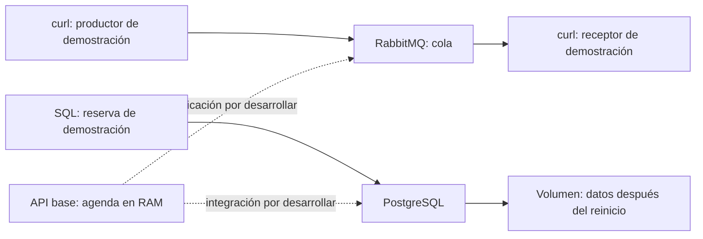

# Datos y mensajes por etapas

## Alcance

La API base guarda reservas en RAM. Este laboratorio permite comprobar servicios, mensajes y persistencia sin atribuir a la API una integración que todavía no tiene. En sesión 12 se trabaja la cola; en sesión 13, los datos y las transacciones. Implementar todo el outbox durante una sola clase no es el mínimo obligatorio.



## Preparación antes de sesión 12

Desde la raíz del repositorio, elija un solo motor. `install_base.sh` incluye `podman-compose`. Si ya instaló solo Podman, prepare su proveedor antes de clase:

```bash
# Debian/Ubuntu, solo si falta el proveedor:
sudo apt-get install -y podman-compose
# macOS, alternativa:
# brew install podman-compose
podman compose version
```

Con Docker, compruebe `docker compose version`. Su instalador Ubuntu incluye el plugin. Podman usa un [proveedor externo de Compose](https://docs.podman.io/en/latest/markdown/podman-compose.1.html), no una implementación propia integrada.

```bash
./modules/06_apis_datos_eventos/start_services.sh
./modules/06_apis_datos_eventos/start_services.sh --apply
# Ruta alternativa Docker:
# ./modules/06_apis_datos_eventos/start_services.sh --motor docker --apply
# Si Docker requiere sudo, ejecute el script anterior con sudo.
```

Para los comandos siguientes use Bash y el mismo motor de arranque:

```bash
motor=(podman)
# Alternativas: motor=(docker) o motor=(sudo docker)
"${motor[@]}" exec librereserva-postgres pg_isready -U curso -d reservas
curl -fsS -u curso:solo-laboratorio http://127.0.0.1:15672/api/overview
```

Espere a que ambos servicios respondan. Los puertos publicados están restringidos a `127.0.0.1`. Las credenciales públicas del ejemplo solo sirven para este laboratorio local. No exponga estos servicios a Internet. La API se ejecuta por separado.

## Sesión 12: un mensaje y un reintento

RabbitMQ guarda mensajes en colas para que otro programa pueda procesarlos después. Una notificación no tiene que bloquear la respuesta de la API. El productor publica, el broker entrega y el consumidor confirma después de procesar.


Usamos la API HTTP de administración para ver el recorrido sin instalar una librería adicional. Es una demostración de desarrollo: un consumidor real debe usar AMQP y confirmar después de realizar su trabajo.

### Declarar y publicar

```bash
curl -fsS -u curso:solo-laboratorio -X PUT \
  http://127.0.0.1:15672/api/queues/%2F/s12-reservas \
  -H 'Content-Type: application/json' \
  -d '{"durable":true,"auto_delete":false,"arguments":{}}'

curl -fsS -u curso:solo-laboratorio -X PUT \
  http://127.0.0.1:15672/api/exchanges/%2F/amq.default/publish \
  -H 'Content-Type: application/json' \
  -d '{"properties":{"delivery_mode":2},"routing_key":"s12-reservas","payload":"{\"evento_id\":\"s12-demo-01\",\"tipo\":\"ReservaCreada\"}","payload_encoding":"string"}'
```

La publicación debe responder `{"routed":true}`. Este mensaje lo produjo `curl`; aún no lo genera LibreReserva.

### Recibir dos veces y retirar

```bash
curl -fsS -u curso:solo-laboratorio -X POST \
  http://127.0.0.1:15672/api/queues/%2F/s12-reservas/get \
  -H 'Content-Type: application/json' \
  -d '{"count":1,"ackmode":"ack_requeue_true","encoding":"auto"}'
```

Repita el comando: el mensaje vuelve a estar disponible porque se reencola. Observe su identificador y el indicador de redelivery. Después ejecute la misma solicitud con `"ackmode":"ack_requeue_false"`: retira el mensaje. Una nueva recepción devuelve `[]` si la cola estaba inicialmente vacía y solo publicó un mensaje.

Este mecanismo HTTP no reproduce el fallo de un consumidor AMQP con un mensaje sin confirmar. Sirve para observar repetición y discutir por qué dos entregas no deben producir dos notificaciones. El ejercicio consiste en diseñar el registro de `evento_id` procesados y el momento de confirmación, no en enviar correos reales.

**Evidencia mínima:** mensaje publicado, dos recepciones del mismo identificador, retirada y decisión sobre cuándo usar una cola. Use RabbitMQ local o el taller SQS de la sesión 12, no ambos como requisito.

## Sesión 13: persistencia y transacciones

El [SQL de demostración](demo_persistencia.sql) crea una tabla independiente y una tabla outbox. No modifica la API ni es una migración automática al iniciar Compose.

```bash
"${motor[@]}" exec -i librereserva-postgres psql -v ON_ERROR_STOP=1 \
  -U curso -d reservas < modules/06_apis_datos_eventos/demo_persistencia.sql
```

### Guardar una reserva y su evento en la misma transacción

```bash
"${motor[@]}" exec -i librereserva-postgres psql -v ON_ERROR_STOP=1 -U curso -d reservas <<'SQL'
BEGIN;
WITH nueva AS (
  INSERT INTO demo_reservas (recurso, inicio, fin)
  VALUES ('A-101', '2026-11-11T18:00:00-05:00', '2026-11-11T19:00:00-05:00')
  RETURNING id, recurso
)
INSERT INTO demo_outbox (reserva_id, evento)
SELECT id, jsonb_build_object('tipo', 'ReservaCreada', 'reserva_id', id, 'recurso', recurso)
FROM nueva;
COMMIT;
SELECT * FROM demo_reservas;
SELECT * FROM demo_outbox;
SQL
```

Ejecute una sola vez en una base sin esa reserva. Repetir el intervalo produce un error de solapamiento: eso prueba la restricción, no idempotencia de la API. Dos intervalos contiguos se permiten porque el rango es semiabierto `[inicio, fin)`.

### Comprobar el volumen

```bash
"${motor[@]}" compose -f modules/06_apis_datos_eventos/compose.yml down
"${motor[@]}" compose -f modules/06_apis_datos_eventos/compose.yml up -d
"${motor[@]}" exec librereserva-postgres pg_isready -U curso -d reservas
"${motor[@]}" exec librereserva-postgres psql -U curso -d reservas \
  -c 'SELECT * FROM demo_reservas;'
```

Espere la disponibilidad antes del SELECT. La fila debe seguir allí. `down` recrea los contenedores pero conserva los volúmenes. No añada `-v`: eliminaría sus datos. Compare este resultado con el reinicio de la agenda en RAM de sesión 9.

### Integración acumulativa del proyecto

| Incremento | Implementación del equipo | Cómo comprobarla |
|---|---|---|
| 1 | Puerto de repositorio y adaptador PostgreSQL | La reserva creada por HTTP sigue tras reiniciar la API |
| 2 | Restricción de solapamiento y traducción del error SQL a `409` | Dos solicitudes incompatibles concurrentes dejan una sola reserva |
| 3 | Reserva y outbox en una transacción | Un fallo revierte ambas escrituras; RabbitMQ apagado no impide persistir |
| 4 · ampliación | Publicador AMQP con confirmación y reintentos; consumidor idempotente | Repetir `evento_id` no repite el efecto; un evento pendiente se entrega al recuperar el broker |

La tabla outbox no publica sola. Marcar un evento antes de confirmar su publicación puede perderlo. Un fallo después de publicar y antes de marcar puede duplicarlo: el consumidor debe tolerar esa repetición. El SQL proporcionado demuestra atomicidad de escritura, no una solución completa de entrega.

El docente prepara el incremento 1 con el equipo antes de exigir el 2. No se evalúan todos los incrementos como una entrega de cuatro horas. Si usa la ruta AWS de sesión 13, identifique que su contrato y persistencia son una implementación independiente.

## Cierre

Detenga el Compose del laboratorio con `down` sin `-v`. Conserve los volúmenes si continuará el proyecto. Elimine únicamente la cola `s12-reservas` desde la consola si no la necesita; no purgue colas compartidas.

Fuentes: [RabbitMQ HTTP API](https://www.rabbitmq.com/docs/http-api-reference), [confirmaciones](https://www.rabbitmq.com/docs/confirms), [restricciones PostgreSQL](https://www.postgresql.org/docs/17/ddl-constraints.html) y [rangos](https://www.postgresql.org/docs/17/rangetypes.html).
