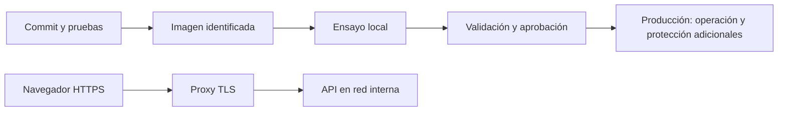

# Ambientes y ensayo de despliegue

## Alcance del proyecto

Material de lectura después de sesión 14 y ampliación opcional de sesión 15. No se crean cuatro ambientes ni una plataforma de producción para completar la sesión 9.


| Ambiente | Propósito | Qué se cambia |
|---|---|---|
| Desarrollo | Editar y depurar | `.venv`, recarga local y datos de prueba |
| Pruebas | Verificar automáticamente | Datos desechables y fallos controlados |
| Staging | Ensayar la entrega | Configuración cercana a producción, sin datos personales |
| Producción | Atender usuarios reales | Secretos protegidos, capacidad, copias, alertas y operación |

Se construye una versión de imagen y se promueve esa misma versión identificable. Variables o nombres de proyecto diferentes no garantizan por sí solos ambientes aislados. Deben separarse datos, permisos, redes y secretos. El repositorio incluye pruebas y laboratorios locales, no ambientes institucionales de staging/producción.



## Ensayo local de proxy TLS

Requiere la imagen de sesión 9 y Compose. La [configuración](ejemplos/compose-proxy.yml) incorpora la API y Caddy como proxy. Solo publica `127.0.0.1:8443`, conserva los certificados del proxy y no publica directamente el puerto de la API. No incluye base de datos ni autenticación: la agenda sigue en RAM.

Use Bash desde la raíz del repositorio:

```bash
motor=(podman)
# Alternativas: motor=(docker) o motor=(sudo docker)
"${motor[@]}" image inspect localhost/librereserva:0.1.0
"${motor[@]}" compose -p librereserva-ensayo \
  -f modules/08_entrega_plataforma/ejemplos/compose-proxy.yml config
"${motor[@]}" compose -p librereserva-ensayo \
  -f modules/08_entrega_plataforma/ejemplos/compose-proxy.yml up -d
```

Caddy usa una autoridad certificadora interna para `localhost`. No intente obtener un certificado público ni abrir puertos de Internet para este ejercicio. Para confiar únicamente en la CA de la demo, extráigala a un directorio temporal nuevo:

```bash
cert_dir=$(mktemp -d)
proxy_id=$("${motor[@]}" compose -p librereserva-ensayo \
  -f modules/08_entrega_plataforma/ejemplos/compose-proxy.yml ps -q proxy)
# Debe existir exactamente un proxy en ejecución.
"${motor[@]}" cp "$proxy_id:/data/caddy/pki/authorities/local/root.crt" "$cert_dir/root.crt"
curl --cacert "$cert_dir/root.crt" https://localhost:8443/salud/viva
curl --cacert "$cert_dir/root.crt" https://localhost:8443/docs -o /dev/null
"${motor[@]}" compose -p librereserva-ensayo \
  -f modules/08_entrega_plataforma/ejemplos/compose-proxy.yml logs --tail=20 api proxy
```

Espere a que el proxy genere la CA y la API responda. No use `curl -k` como solución de producción. No instale esta CA en el almacén global del equipo. El navegador puede rechazar el certificado; la validación del taller se realiza con `curl --cacert`.

Finalice con el mismo proyecto y archivo:

```bash
"${motor[@]}" compose -p librereserva-ensayo \
  -f modules/08_entrega_plataforma/ejemplos/compose-proxy.yml down
```

No use `down -v` si necesita conservar los certificados. Los volúmenes del proxy no conservan las reservas de la API.

## Versión y vuelta atrás en Compose

Mantenga disponibles imágenes distintas. Para ensayar `0.1.1`, primero constrúyala y pruebe el cambio según [operación](OPERACION.md). Después:

```bash
LIBRERESERVA_IMAGE=localhost/librereserva:0.1.1 "${motor[@]}" compose \
  -p librereserva-ensayo -f modules/08_entrega_plataforma/ejemplos/compose-proxy.yml up -d
```

Si su motor requiere `sudo`, este puede filtrar la variable: exporte el valor mediante `sudo env LIBRERESERVA_IMAGE=localhost/librereserva:0.1.1 docker compose ...` con los mismos argumentos de proyecto y archivo. Compruebe la imagen aplicada con `compose config` usando el mismo entorno. Para regresar, repita con `0.1.0`. Volver de imagen no revierte datos y reiniciar esta API pierde la agenda.

## Antes de un despliegue real en VM/EC2

La guía de entorno explica instalar Docker y acceder por túnel SSH a una instancia existente. No aprovisiona VM, DNS, firewall ni certificados públicos. El ensayo anterior no autoriza abrir servicios al exterior.

Un despliegue real requiere aprobación institucional, dominio y DNS, proxy con certificado válido, autenticación/autorización, base de datos integrada, backups probados, gestor de secretos, permisos mínimos, señales de salud de dependencias, límites y logs/métricas. Documente procedimiento de actualización, compatibilidad de migraciones y recuperación. La API base no cumple todavía estos requisitos.

## Elección de plataforma

| Alternativa | Cuándo evaluarla | Evidencia del curso |
|---|---|---|
| VM con Compose | Pocos servicios y capacidad operativa limitada | Ensayo de proxy local y ADR; no alta disponibilidad |
| Servicio gestionado | Delegar parte de la operación | Ruta Lambda de sesión 13 si está habilitada; es otra implementación |
| Kubernetes | Necesidad comprobada de réplicas, equipos o nodos | Laboratorio kind; no clúster productivo |
| Cola y trabajador | Tareas asíncronas o por lotes | RabbitMQ/SQS en sesión 12; una cola no ejecuta tareas por sí sola |

**Evidencia:** una alternativa justificada, recorrido HTTPS o cambio de versión, limitaciones y limpieza. No se exige construir las cuatro alternativas.

Fuentes: [HTTPS de Caddy](https://caddyserver.com/docs/automatic-https), [reverse proxy](https://caddyserver.com/docs/caddyfile/directives/reverse_proxy) y [Compose](https://docs.docker.com/reference/compose-file/).
