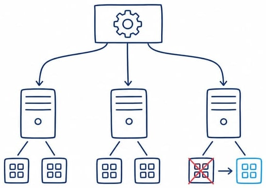

# Operación: ampliaciones de sesión 15

El mínimo de sesión 14 es desplegar, acceder a la API y observar la recuperación de un Pod. Este documento amplía ese recorrido. Elija una etapa para el proyecto; no complete todas como requisito de la misma jornada.



## 1. Escalar, actualizar y volver atrás

Requiere haber terminado el [despliegue básico](README.md), mantener el clúster `informatica1` activo y usar Bash. No use esta práctica sobre un clúster institucional o de producción. La API base conserva una agenda por proceso: las réplicas no comparten reservas.

```bash
kubectl config current-context
# Debe indicar kind-informatica1. Si no coincide, deténgase.
kubectl scale deployment/librereserva --replicas=3
kubectl rollout status deployment/librereserva --timeout=120s
kubectl get pods -l app=librereserva
```

Escalar permite observar reconciliación; no demuestra consistencia de reservas entre réplicas. `port-forward` al Service selecciona un Pod y no sirve para comprobar distribución entre todas las réplicas.

### Actualización de una imagen preparada

En una rama del equipo, cambie la versión declarada en la API y pruebe antes de construir `0.1.1`. Si solo reconstruye el mismo código, estará demostrando un cambio de etiqueta, no una nueva funcionalidad.

```bash
motor=(podman)
# Alternativas: motor=(docker) o motor=(sudo docker)
"${motor[@]}" build -f labs/librereserva/Containerfile \
  -t localhost/librereserva:0.1.1 labs/librereserva
# Con Podman: export KIND_EXPERIMENTAL_PROVIDER=podman
kind load docker-image localhost/librereserva:0.1.1 --name informatica1
kubectl set image deployment/librereserva api=localhost/librereserva:0.1.1
kubectl rollout status deployment/librereserva --timeout=120s
kubectl rollout history deployment/librereserva
kubectl get pods -l app=librereserva
```

Para regresar a la revisión anterior de la plantilla del Deployment:

```bash
kubectl rollout undo deployment/librereserva
kubectl rollout status deployment/librereserva --timeout=120s
kubectl get deployment librereserva -o jsonpath='{.spec.template.spec.containers[0].image}'
kubectl scale deployment/librereserva --replicas=2
```

El rollback no recupera la memoria de los procesos ni deshace migraciones de datos. Mantenga disponibles ambas imágenes. Actualice el manifiesto versionado cuando decida cuál es el estado final; los cambios con `kubectl` no editan el archivo Git. El regreso esperado es `localhost/librereserva:0.1.0` si la única actualización fue la descrita.

## 2. Configuración, secretos y almacenamiento

La [demo separada](ejemplos/configuracion-volumen.yml) usa un Pod BusyBox. No conecta secretos ni archivos con LibreReserva y no se debe presentar como persistencia de la API. La separación permite aprender tres objetos sin implementar a la vez un adaptador de base de datos.

```bash
kubectl create namespace entorno-demo
kubectl -n entorno-demo create secret generic credencial-demo \
  --from-literal=CLAVE=solo-laboratorio
kubectl get storageclass
kubectl apply -f modules/08_entrega_plataforma/ejemplos/configuracion-volumen.yml
kubectl -n entorno-demo get pvc,pods
kubectl -n entorno-demo wait --for=condition=Ready pod/entorno-demo --timeout=120s
kubectl -n entorno-demo exec entorno-demo -- sh -c \
  'printf "Ambiente: %s\n" "$AMBIENTE"; test -n "$CLAVE"; cat /datos/registro.txt'
```

El Secret contiene un valor ficticio, no una credencial real. No muestre su contenido ni guarde secretos reales en comandos, historial, YAML o Git. Base64 no equivale a cifrado y un objeto Secret requiere controles de acceso y protección del clúster.

Debe existir una StorageClass predeterminada que aprovisione el PVC. Si queda `Pending`, examine `kubectl -n entorno-demo describe pvc datos-demo`; no continúe afirmando que ya tiene persistencia.

### Reemplazar el Pod conservando el archivo

```bash
kubectl -n entorno-demo delete pod entorno-demo
kubectl apply -f modules/08_entrega_plataforma/ejemplos/configuracion-volumen.yml
kubectl -n entorno-demo wait --for=condition=Ready pod/entorno-demo --timeout=120s
kubectl -n entorno-demo exec entorno-demo -- cat /datos/registro.txt
```

La fecha original del archivo debe permanecer. Un PVC local no garantiza supervivencia a la eliminación del clúster, fallo del host ni movilidad entre nodos. No lo monte como solución de datos compartidos de varias réplicas de la API.

Al terminar, retire únicamente esta demo con `kubectl delete namespace entorno-demo`. Esto elimina el Secret, el Pod y el PVC del ejercicio; según la política del volumen, puede eliminar también sus datos. Conserve la evidencia antes de hacerlo.

## 3. Modelo multinodo, solo si es necesario

El clúster básico de `kind` tiene un nodo; el dibujo de tres trabajadores de la presentación es un modelo conceptual. Para una ampliación, existe una [configuración independiente](ejemplos/kind-multinodo.yml):

```bash
kind create cluster --name informatica-multinodo \
  --config modules/08_entrega_plataforma/ejemplos/kind-multinodo.yml
kubectl --context kind-informatica-multinodo get nodes
```

Son nodos simulados como contenedores en un mismo equipo, no cuatro máquinas independientes ni alta disponibilidad real. Reserve memoria suficiente. No despliegue el proyecto aquí si está trabajando la demo básica. Después de registrar los nodos, `kind delete cluster --name informatica-multinodo` elimina este clúster y sus datos. Compruebe el contexto antes de retomar el proyecto.

## Evidencia

Una ampliación, su estado anterior y posterior, comandos, resultado esperado y limitación. Para el cierre, explique si el problema era ejecución, configuración o datos.

Fuentes: [actualizaciones y rollback](https://kubernetes.io/docs/concepts/workloads/controllers/deployment/), [ConfigMap](https://kubernetes.io/docs/tasks/configure-pod-container/configure-pod-configmap/), [Secret](https://kubernetes.io/docs/concepts/configuration/secret/) y [kind](https://kind.sigs.k8s.io/docs/user/configuration/).
