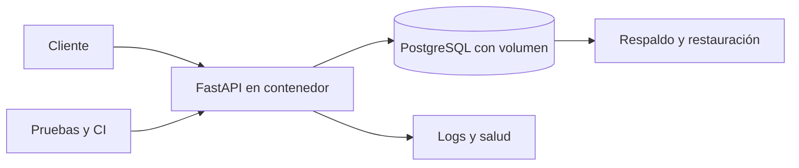

# Módulo 12. Proyecto integrador: LibreReserva robusta

## Resultado

Entregar una aplicación pequeña, persistente, reproducible, diagnosticable y recuperable, construida mediante incrementos sobre una sola arquitectura.

## Instalación paso a paso

No existe una instalación nueva para el proyecto. Desde un clon limpio se preparan únicamente Docker o Podman, Compose, Python y las variables documentadas; después se ejecutan pruebas, migraciones, PostgreSQL y la imagen de la API siguiendo el README del equipo.

## Arquitectura final

LibreReserva permanece como monolito modular. La API ejecuta las reglas; PostgreSQL conserva datos e integridad. Compose describe el ambiente local. CI verifica la revisión y construye una imagen identificable.

## Iteraciones

1. **Línea base:** Docker local y pérdida de estado demostrada.
2. **Diseño:** cuatro escenarios, C4 y dos ADR.
3. **Datos:** puerto, adaptador PostgreSQL, migraciones y concurrencia.
4. **Confiabilidad:** idempotencia, errores, vida, disponibilidad y recuperación.
5. **Entrega:** pruebas, CI, imagen por commit y configuración externa.
6. **Operación:** logs, medición, respaldo, restauración y runbook.
7. **Integración:** reproducción completa desde un clon limpio.
8. **Defensa:** caso feliz, fallo, recuperación y deuda reconocida.

## Definición de terminado

- Las instrucciones funcionan desde un clon limpio.
- Las pruebas unitarias, de contrato, integración y HTTP pasan.
- Las migraciones construyen el esquema desde una base vacía.
- Una reserva sobrevive al reinicio de la API.
- Dos solicitudes concurrentes incompatibles confirman una sola reserva.
- Repetir una solicitud con la misma clave no duplica el efecto.
- Vida y disponibilidad representan estados diferentes.
- La imagen se relaciona con un commit y no contiene secretos.
- Los logs permiten seguir una solicitud sin revelar datos sensibles.
- Un respaldo se restaura en un volumen limpio.
- Los diagramas y ADR representan la implementación real.

## Jornada autónoma

La semana 15 no añade tecnologías ni funcionalidades. Cada equipo clona su versión candidata en un directorio limpio, ejecuta la definición de terminado, corrige defectos dentro de la arquitectura existente y registra la deuda que no pueda cerrar.

## Defensa

Quince minutos por equipo: arquitectura y decisiones; construcción desde revisión identificada; caso feliz; concurrencia e idempotencia; caída y recuperación; logs; respaldo restaurado; deuda. Cada integrante debe poder explicar y modificar el incremento.

**Evidencia:** etiqueta o commit final, identificador de imagen, paquete de pruebas, migraciones, runbook, ADR y matriz requisito–evidencia.

## Validación

La lista de definición de terminado se ejecuta completa desde un clon limpio. Una capacidad que no pueda reproducirse se registra como deuda y no se presenta como terminada.
