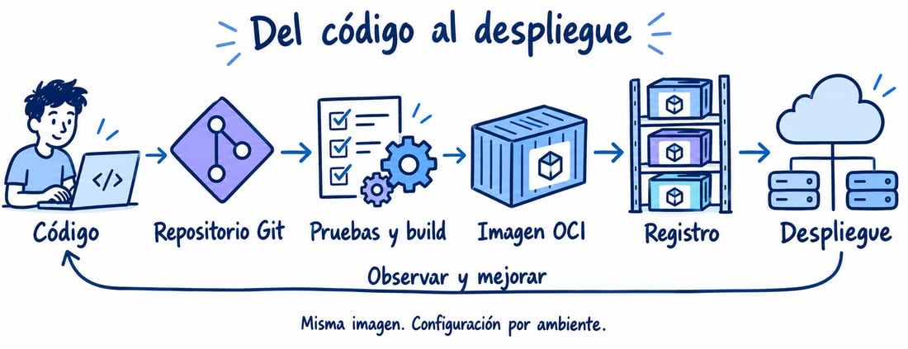
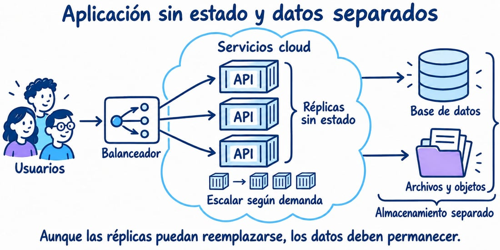

# Módulo 12. Proyecto integrador: LibreReserva operable

## Resultado

Integrar arquitectura, código, entrega, operación, seguridad e IA responsable en un producto pequeño y defendible.

## Visión de la evolución del proyecto



El proyecto relaciona código revisado, pruebas y una versión ejecutable. No exige incorporar todas las herramientas del dibujo a la vez.



Aunque la ejecución de la aplicación pueda cambiar de instancia, los datos deben conservarse en servicios separados. Cada equipo justifica si conviene una VM, un servicio gestionado o Kubernetes, y cómo conservará los datos al sustituir una instancia. Autoescalado y almacenamiento gestionado no reemplazan pruebas, backups, control de acceso ni límites de costo. Declare si su incremento sigue usando agenda en RAM.

## Instalación paso a paso

No existe una instalación adicional única. Prepare únicamente las capacidades elegidas y registre versiones:

```bash
./scripts/check_environment.sh
./scripts/setup_python.sh --apply
make check
make test
```

Después prepare solo la arquitectura y la ampliación aprobadas para el equipo. La [ruta por sesiones](../../docs/RUTA_CONTENEDORES.md) evita convertir esta lista en instalaciones obligatorias simultáneas:

1. Módulo 6: PostgreSQL y RabbitMQ.
2. Módulo 8: Podman, kind, kubectl y Forgejo.
3. Módulo 9: OpenTelemetry y backends seleccionados.
4. Módulo 10: Gitleaks, Syft, Trivy y ZAP.
5. Módulo 11: Ollama/Continue solo si el experimento local es viable.

## Iteraciones

1. **Descubrimiento:** actores, alcance, escenarios, C4 y dos ADR.
2. **Incremento:** crear y consultar reservas con persistencia y pruebas.
3. **Entrega segura:** CI, imagen OCI, SBOM y despliegue local.
4. **Operación:** telemetría, SLO, alerta y fallo controlado.
5. **IA y cierre:** comparación asistida, deuda, costo, README y defensa.

## Definición de terminado

El mínimo común es pruebas, una imagen identificable, despliegue reproducible, una reserva, un caso de fallo y una decisión explicada. Persistencia, mensajería, SBOM y telemetría se exigen según los incrementos practicados y acordados. Cada equipo realiza una ampliación de sesión 15, no todas las iteraciones avanzadas a la vez.

- Criterios aprobados y revisión de otra persona.
- Pruebas por riesgo y contrato actualizado.
- Telemetría suficiente y amenaza examinada.
- Ningún secreto o dato personal confirmado.
- Imagen trazable por digest y despliegue reproducible.
- Asistencia de IA declarada y comprendida.

## Validación final

Un evaluador parte de un clon limpio y debe poder crear entorno, ejecutar pruebas, construir imagen, desplegar y crear/consultar una reserva. Además reproduce la ampliación acordada: persistencia, evento, recuperación, proxy o medición. SBOM y trazas centralizadas se exigen solo cuando fueron practicados y anunciados. Cada capacidad no implementada se registra como deuda con riesgo, responsable y fecha; no se presenta como una funcionalidad operativa.

## Defensa

Quince minutos: problema y decisión; recorrido funcional; fallo inducido y diagnóstico; control de seguridad; resultado de IA; deuda reconocida. Después, cada integrante realiza un cambio pequeño seleccionado al azar.

**Evidencia:** etiqueta de versión, digest, paquete de evidencias y matriz resultado de aprendizaje–archivo.
